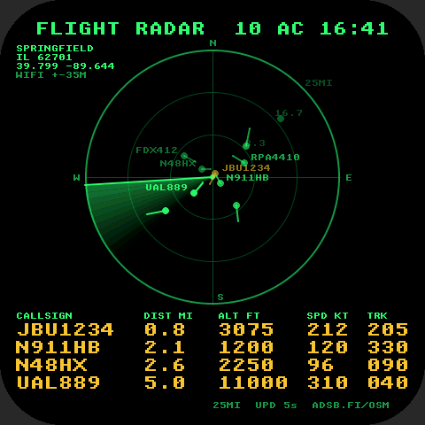

# ESP-Mosaico Flight Radar (Vibe Mode app)



A green-phosphor radar showing live aircraft around wherever the Mosaico is,
installed as a **normal Mosaico app next to Vibe Mode**. Vibe Mode, your
Ideas and your settings stay in place.

* Rotating sweep. Aircraft light up as it passes, then fade. Heading lines show direction; longer means faster.
* Callsign tags on the 6 nearest. Nearest in amber. Table of the 4 nearest.
* Blinking **OVERHEAD!** when a plane is within ~1 mile.
* **Tap the screen** to cycle the range: 2 / 5 / 10 / 25 mi.
* Uses the **Wi-Fi saved in Vibe Mode** automatically.
* **Finds its own location** at every start-up: nearby Wi-Fi networks first, then the internet (IP) address. Town, state, ZIP, coordinates and source are shown in the top-left corner.
* Data: [adsb.fi](https://adsb.fi) open data, refreshed every 10 s (personal, non-commercial use).

## Requirements

* ESP-IDF at the commit the Mosaico workspace pins: `7b9cc1ac79f865983f59bb8ff3ff43eb74ff1dbe`
* Python 3.10+ and Git 2.28+
* The [esp-mosaico-vibe](https://github.com/esp-mosaico/esp-mosaico-vibe) workspace

## Install

```bat
:: 1. Workspace (once)
cd C:\esp
git clone https://github.com/esp-mosaico/esp-mosaico-vibe.git
cd esp-mosaico-vibe
git submodule update --init submodule/esp-mosaico-utils submodule/esp-mosaico-bsp

:: 2. Copy this folder to  C:\esp\esp-mosaico-vibe\projects\flight_radar

:: 3. Load ESP-IDF, then build + install through Vibe Mode (Mosaico connected by USB-C)
C:\esp\espv6.2esp-idf\export.bat
cd C:\esp\esp-mosaico-vibe
python mosaico.py iris system-update --project projects/flight_radar
```

If `system-update` reports that the board's base system is missing or incompatible,
run `python mosaico.py recover` once, then run `system-update` again.

## Everyday use

| Task | How |
|---|---|
| See logs | `python mosaico.py iris logs --project projects/flight_radar` |
| Reinstall after code changes | `python mosaico.py iris app-update --project projects/flight_radar` |
| Get back to Vibe Mode | Hold the **AI** button while powering on |
| Change location / units / API | `idf.py -C projects/flight_radar menuconfig` → *Flight Radar*, then `system-update` |
| Fix the location by hand | menuconfig → *Flight Radar* → set *Manual latitude* and *Manual longitude* (leave empty for automatic) |

Logs go through ESP-Iris over USB (`iris logs`). Plain `idf.py monitor` won't show them,
because the console is on UART in Mosaico apps.

## Location

There is no built-in default location. At every start-up the radar works out where it is,
once, and nothing is saved between boots:

1. **Manual:** if *Manual latitude/longitude* are set in menuconfig, those are used.
2. **Wi-Fi:** otherwise, it scans nearby Wi-Fi networks and sends their router MAC
   addresses and signal strengths (never network names) to [beaconDB](https://beacondb.net),
   an open location database. It skips networks whose names end in `_nomap` and randomised MACs.
3. **IP:** if that fails, it uses [ipinfo.io](https://ipinfo.io), which is city-level from
   your internet address and can be many miles off.

It then looks up the town name with one request to OpenStreetMap's
[Nominatim](https://nominatim.org), following its
[usage policy](https://operations.osmfoundation.org/policies/nominatim/): one request per start-up,
with an identifying User-Agent. Place data © OpenStreetMap contributors (ODbL), credited as `OSM` on screen.

The top-left corner shows, for example:

```
SPRINGFIELD
IL 62701
39.799 -89.644
WIFI +-35M        <- or IP (APPROX) / MANUAL
```

If it says `IP (APPROX)` and the town is wrong, beaconDB has no Wi-Fi data for your area yet.
Set the manual coordinates instead. If every method fails, the corner shows `NO LOCATION`
and the radar waits.

## What differs from a standalone ESP-IDF project

Based on the official `hello_world` template (`mosaico.py project init`), with its
GSP demo UI replaced by an LVGL radar:

* `partitions.csv` and `sdkconfig.defaults` are the template's, unchanged. They keep the Vibe Mode memory layout.
* `main/main.c` starts ESP-Iris and `iris_ota_support_start()` first, so updates and Vibe Mode stay reachable.
* `sdkconfig.application.defaults` = the template's settings plus LVGL fonts, TLS and display settings.
* Wi-Fi is read from Vibe Mode's shared settings (`sysmeta` → `shared` → `wifi_ssid`/`wifi_password`).

## Status

The radar UI and the data parser were compiled and run on a PC with real LVGL 9.5.
The Mosaico layout passes Espressif's `validate_native_layout.py`. This exact project
has **not yet been built with ESP-IDF or installed on hardware**. If a step fails,
paste the error.
